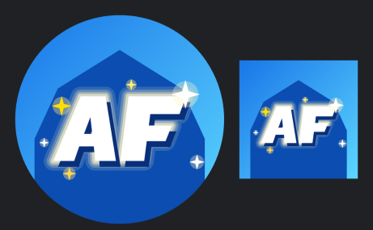
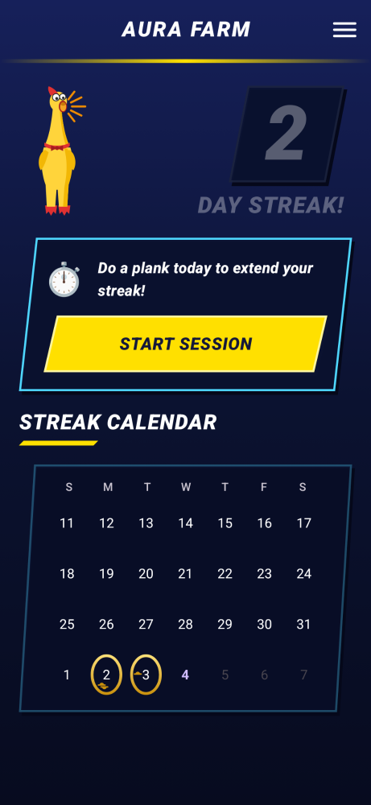
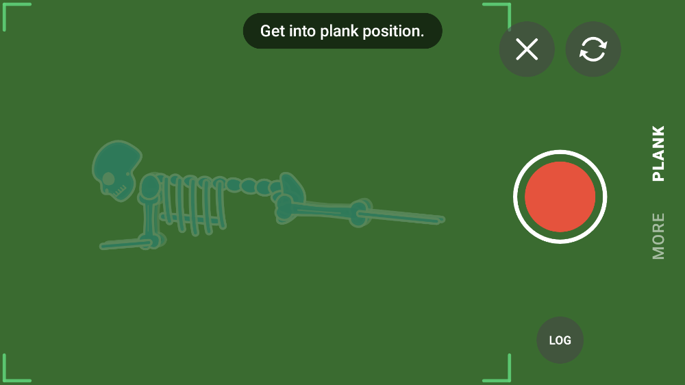
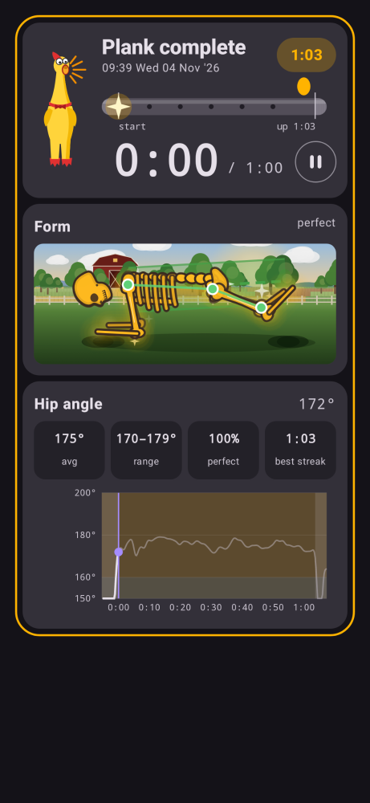

# Aura Farm



An Android app that makes a daily plank fun. Prop your phone side-on, get into a plank, and it watches you: it
draws you as a gold skeleton on a farm, gives you a golden aura for good form, and a rubber chicken, your coach,
clucks at you while you hold. A 60 second plank earns the day a golden egg on your streak calendar.

Everything runs on the phone. Pose detection (MediaPipe Pose) is on-device, the camera picture is not stored or sent by the app's own code,
and there are no accounts. (One honest caveat about the Internet permission is in [docs/DESIGN.md](docs/DESIGN.md#privacy).)

*(Aura Farm was called Coach Chicken until v0.6.0. The chicken is still the coach, and the repository keeps its old name.)*

| Home | Getting ready | The plank card |
|---|---|---|
|  |  |  |

## Install

Download `aura-farm-vX.Y.Z.apk` from the [latest release](https://github.com/campey/coach-chicken/releases/latest) and open
it on an Android phone (8.0 or newer, 64-bit ARM). Android will ask you to allow installing from your browser or file manager.

**Coming from Coach Chicken (v0.5 and earlier)?** Aura Farm is a different app to Android (new package `com.aurafarm`), so it
installs *next to* the old one rather than over it. To bring your planks with you: in the old app open the menu and tap
**Back up data**, install Aura Farm, open its menu and tap **Restore data**, then uninstall the old app so you don't get
reminders twice. See [docs/RELEASING.md](docs/RELEASING.md#the-package-name-change) for the detail.

## What it does

- **A session** switches the phone to landscape and shows the camera as a viewfinder with a ghost target skeleton to get into.
  Hold a plank for about a second and the timer starts by itself. Get up and it ends by itself.
- **Form checks** judge the side the camera sees best: a straight line from shoulder through hip and knee to ankle, forearms
  propped under the shoulders. Hips sagging, piking, or being on all fours or with your knees on the floor do not count.
- **Gold and aura.** Perfect form turns the skeleton gold and builds a glow and sparkles that grow the longer you hold it.
- **The chicken coaches**: a quiet cluck throughout, a loud one every 10 s, a squawk at 60 s, and a building *bwaaak* if your
  form slips for more than a second (you get 3 s to recover).
- **A card for every plank**: a replay you can scrub, the form at each moment and a hip-angle graph, shown after the plank
  and from the calendar. You can share it as a picture.
- **A streak and a calendar** of golden eggs, daily reminders (6:00, 13:00, and a 21:00 streak saver), and backup and restore
  of all of it.

More in [docs/DESIGN.md](docs/DESIGN.md).

## Documentation

| | |
|---|---|
| [docs/ARCHITECTURE.md](docs/ARCHITECTURE.md) | How the code is laid out and how a frame travels from the camera to the screen |
| [docs/DEVELOPMENT.md](docs/DEVELOPMENT.md) | Building, testing, the headless screenshot tests, tuning the form checks from a pose log |
| [docs/DESIGN.md](docs/DESIGN.md) | The product, the rules the form checks use and why, the visual language, the brand |
| [docs/DATA.md](docs/DATA.md) | Every file format: plank recordings, session history, backups, the pose log |
| [docs/RELEASING.md](docs/RELEASING.md) | Cutting a release, signing, version numbers, the package name change |
| [docs/DEVICE-CHECKLIST.md](docs/DEVICE-CHECKLIST.md) | What the automated tests can't see, to check on a real phone before a release |
| [docs/ROADMAP.md](docs/ROADMAP.md) | What is planned, in what order, and the open decisions |
| [CHANGELOG.md](CHANGELOG.md) | What changed in each release, and [docs/release-notes/](docs/release-notes/) for the full notes |
| [docs/PROTOTYPE.md](docs/PROTOTYPE.md) | The original Python prototype (`coach.py`), kept for reference |
| [CLAUDE.md](CLAUDE.md) | Orientation for AI coding assistants working in this repository |

## Building it

You need JDK 17 and the Android SDK (`ANDROID_HOME`, or `sdk.dir` in `android/local.properties`). There is no Gradle wrapper
in the repository: use Gradle 8.14.3 (that is what CI uses).

```
cd android
gradle :core:test :app:assembleDebug     # unit tests, then app/build/outputs/apk/debug/app-debug.apk
```

The app is arm64 only (MediaPipe's native libraries are large), so it will not run on an x86 emulator. See
[docs/DEVELOPMENT.md](docs/DEVELOPMENT.md) for the screenshot tests, which render the screens without a phone or emulator.

## Contributing

Issues and ideas are welcome on the [issue tracker](https://github.com/campey/coach-chicken/issues). Start with
[docs/DEVELOPMENT.md](docs/DEVELOPMENT.md). There is no licence file yet, so by default nobody has the right to reuse the code;
adding one is on the [roadmap](docs/ROADMAP.md).

## Credits

The rubber chicken is inspired by the one with a pulley in the middle from *The Secret of Monkey Island*. The sounds are
synthesised placeholders (`tools/generate_sounds.py`). Pose detection is Google's
[MediaPipe Pose Landmarker](https://ai.google.dev/edge/mediapipe/solutions/vision/pose_landmarker) (the lite model is bundled in the app).
